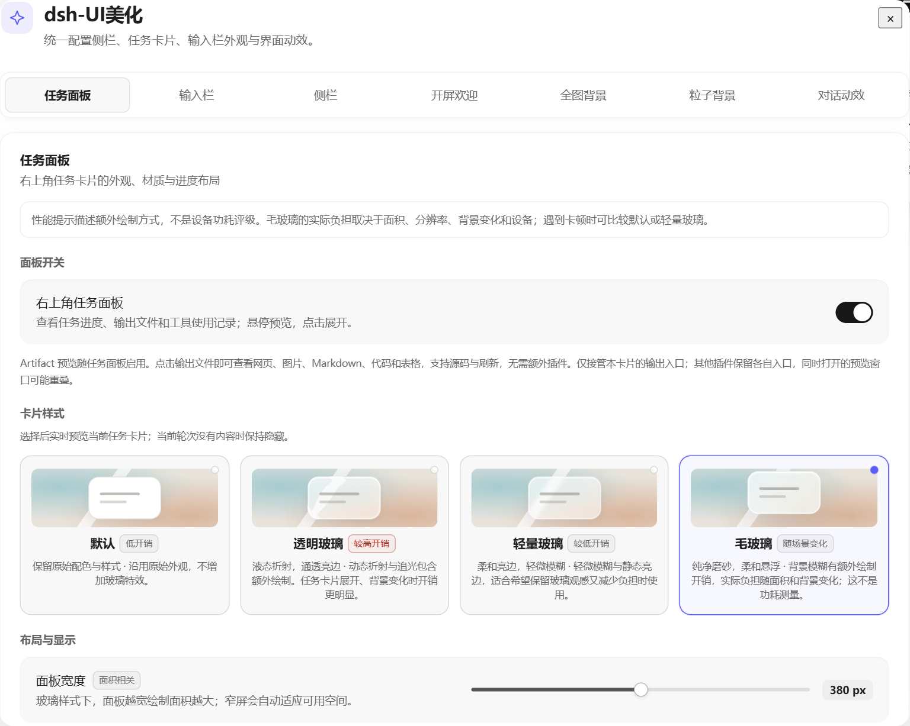
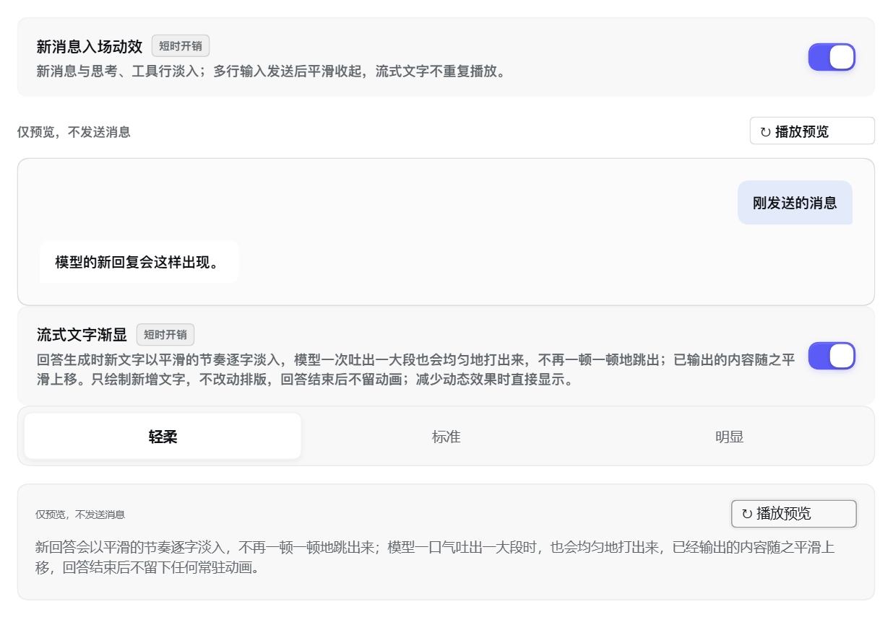
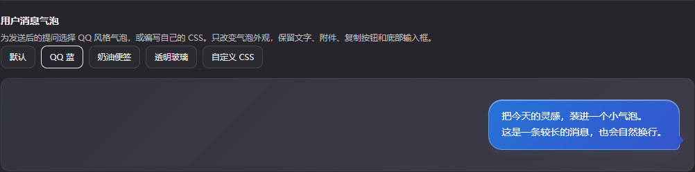

# dsh-UI美化

当前版本 **0.4.2**（流式输出与滚动平滑版，见 [0.4.2 发布说明](docs/RELEASE-0.4.2.md)）。0.4.0 的功能、可调项与兼容边界参阅 [0.4.0 发布说明](docs/RELEASE-0.4.0.md) 和 [验证记录](docs/validation-0.4.0.json)。

为 DeepSeek Harness 提供独立的任务面板、输入栏与侧栏材质，以及背景、主题切换和对话动效。各区域分别配置，默认样式排在材质选项最前面。

设置入口：**设置 → dsh-UI美化**。仓库、包名和插件标识统一为 `dsh-ui-beautify`；旧版 `dsh-claude-beautify` 的本机偏好会自动迁移。代码 MIT；可选鲸鱼娘素材为 CC BY-NC-SA 4.0，详见许可说明。

[0.4.4 发布说明](docs/RELEASE-0.4.4.md) · [功能详解](docs/FEATURES.md) · [交付与兼容](docs/DELIVERY.md) · [更新记录](CHANGELOG.md) · [安装](#安装与更新) · [来源与许可](THIRD_PARTY_NOTICES.md)

「全局配置」中的内置「默认值」预设可还原全部美化选项和两种窗口宽度，保留已导入素材，并支持撤销上次应用。详见 [恢复默认说明](docs/SETTINGS-RESET.md)。

「全局配置」分类支持导入与导出所有分类、独立黑白主题、自定义 CSS、工具栏和聊天宽度。默认导出轻量 JSON；开启「包含本机素材」后可导出背景、开屏、粒子和自定义动图包的完整备份。导入先查看摘要，支持撤销；素材变更后按提示刷新界面。详见 [配置备份与迁移](docs/SETTINGS-TRANSFER.md)。







截图使用合成内容。Artifact 预览见 [截图](assets/screenshots/artifact.png)。

底部的轮次/速度、Token 用量及上下文统计弹层支持平滑展开、退场与连续反向。详见 [统计弹层过渡](docs/STAT-POPOVER-MOTION.md)。

左侧栏收起时，边缘箭头旁以小气泡提醒其他会话的完成、待回答和失败状态，各自带独立图形动画；点击或展开侧栏后平滑消失。边缘箭头始终可见，方向随开合过渡。详见 [其他会话状态提醒](docs/SIDEBAR-ATTENTION.md)。

自定义背景下的行内代码、文件附件、文件改动卡片与消息操作会随明暗主题适配，减少突兀白底；原生展开、预览和键盘操作保持一致。详见 [背景下的聊天样式](docs/BACKGROUND-CHAT-SURFACES.md)。

## 功能一览

| 设置分类 | 可以调整的内容 |
| --- | --- |
| **任务面板** | 右上角任务进度、输出文件、工具与资源摘要；悬停预览或点击固定；按当前轮或全部轮次浏览；选择卡片材质、280–480px 宽度、默认 2/3 步和栏目开合。 |
| **输入栏** | 独立选择输入框材质；独立开启小按钮 Lens 玻璃；选择对话是否滚到输入栏后方；保留原生输入、模型选择、录音、发送和停止操作。 |
| **侧栏** | 独立选择侧栏材质和切换动效；左右面板覆盖主屏幕或恢复并排布局；顶部标题、标签与正文对齐，显示实际所属项目；圆角和选中反馈跟随明暗主题。 |
| **开屏欢迎** | 默认 Logo 字符填充；也可导入单文件代码、图片、动图或视频，直接预览。旧版书写模式自动迁移到默认字符 Logo。 |
| **全图背景** | 本机图片、视频与 HTML 素材库；点击名称或铅笔可重命名；日夜主题分别记住选择、启用状态和上一张；调整可见度、模糊、铺放、位置和视频声音。 |
| **粒子背景** | DeepSeek Logo、鲸鱼娘、自定义图片或 SVG；图片细节优先取点、选图建议和完整成形缩略预览；500–20000 颗粒子；手动调整成形进度，或跟随真实上下文占用；设置开始显示与完整成形阈值；成形后保持粒子漂浮。 |
| **思考动图** | 内置鲸鱼娘 51 个动作；ZIP / 文件夹导入动图包；自由勾选动作，随机或固定播放，调整图标大小、文字间距与“深度求索中……”文案（可填多条随机显示，用 `{time}` 自定义用时位置）。原独立动图插件可迁移卸载，见[动图包制作与迁移说明](docs/RUNNING-ANIMATION-PACKS.md)。 |
| **对话动效** | 默认、轻盈卡片、极简分隔；用户消息气泡的 QQ 蓝、便签、玻璃和自定义 CSS；艺术字、自定义分隔动图和 CSS；新消息入场预览与开关。 |

顶部另有 **日夜主题开关** 和 **纯背景模式**：后者隐藏聊天文字、输入栏、顶部及两侧界面，只保留清晰的背景和粒子。右上角图标或 Esc 可退出，恢复原来的草稿、阅读位置和背景模糊设置。详见 [纯背景模式](docs/BACKGROUND-ONLY.md)。

“组件布局 → 任务面板”设置任务面板。“对话布局 → 欢迎语”设置新会话页面鲸鱼图标后的文字：可使用原始标题、从自定义列表随机选择，或用 JavaScript 根据 `context.hour`、`context.minute`、`context.day` 和 `context.theme` 返回文字。自定义代码区可载入按时间问候的示例。LOGO 可隐藏、调整大小，或上传 PNG、JPG、GIF、WebP 图片并切回默认鲸鱼；图片保存在本机，完整备份包含图片。可隐藏“预览版”标签并编写 CSS 调整欢迎语样式；图标与文字整体保持居中。设置页提供预览，修改自动保存；代码在本机隔离执行，执行失败时恢复原始标题。

“全局配置”可以给当前设置和素材保存本机预设、命名并快速切换，也提供内置默认值和配置导入导出。素材较多时预设占用更多本机空间，部分素材切换后需要刷新界面。

“对话布局 → 对话动效”可自定义新消息入场：载入当前动效示例后，分别编辑 `user`、`assistant`、`process` 的 JSON 动画帧、时长和缓动，点击应用后用于聊天与播放预览。编辑草稿不会改变当前效果；无效代码不会覆盖已应用设置，也可随时切回默认动效。

顶部标题和「对话 / 轨迹 / 上下文」支持宿主的插槽包装布局，跟随当前可见视图定位；隐藏的聊天和嵌套会话不会把标签带偏。

中间聊天区继续使用 DSH 原生两侧拖动控件调宽，**普通窗口**与**全屏 / 最大化**分别记住宽度，切换和刷新后恢复。缩窗时只临时适配当前可用空间，不覆盖已保存宽度；桌面侧栏覆盖模式会为左侧栏预留安全距离，避免正文和输入栏被挡住。窄屏沿用宿主抽屉交互。偏好只保存在当前浏览器来源，桌面与浏览器各自记忆。

设置分类会记住上次选择：关掉设置、刷新或在同一浏览器来源重新打开后继续回到该分类。无效分类回到“任务面板”；本机存储不可用时保留本次窗口内的选择。分类切换支持方向键、Home/End，窄窗口可横向滑动。

设置页的布尔开关统一使用 iOS 式胶囊轨道与白色圆形滑钮，开启跟随宿主主题色，关闭为中性灰；可视尺寸为 44×26px，触控热区至少 44px。暗色主题的材质选中点和信息状态点使用局部静态荧光，未选中点不发光。开关回弹复用统一动效曲线，支持键盘、禁用与焦点状态；减少动态效果时直接切换，强制颜色下使用系统色并去掉荧光。共享控件样式位于 `src/settings-controls.js`。

进度面板切换「当前轮次 / 全部轮次」或前后轮次时，内容相同就不重播整块刷新动效；选中状态和轮次信息照常更新。

粒子图片推荐透明背景、单一主体、轮廓清晰和明暗对比强的素材。导入后优先采样图中各处的线条与局部细节，不套用固定的人脸位置；彩色底图仍会参与取点，需要预先去底。**粒子背景 → 本机图片** 下的完整成形缩略预览随粒子数和明暗主题更新，静止后不持续绘制；聊天的转换进度保持独立。已有图片刷新后直接使用新采样，无需重导。

配置两份 HTML 时，先切到日间主题，应用日间背景，再切到夜间主题应用另一份。刷新后分别恢复；关闭或清除只影响当前主题。升级前的 HTML 归入升级时的当前主题，另一侧留空；原有图片、视频沿用到两侧。素材库共用，可见度、模糊等外观参数仍共用。

开屏、背景和用户消息气泡顶部并列标注日夜两套配置、启用状态、当前主题与编辑目标。自定义代码开屏支持“交互完成后结束”，该模式下提供“手势开屏示例”以录入九宫格图案；生成后点击应用保存，始终保留跳过和 Esc。详见 [自定义开屏](docs/CUSTOM-OPENING.md)。

定时与交互代码按日夜主题分成四份，切换恢复各自代码与设置页草稿，应用后持久保存。代码页会把已保存的开屏放进“本机开屏历史”，点击历史卡片即可快速切换。日间／夜间配置卡片可直接切换宿主主题，并与右上角黑白开关同步。Desktop 可使用本机提前引导补丁，从加载插件阶段直接显示自己的开屏，再由正常美化插件接管；补丁须在 Desktop 退出后应用，下次启动生效。

## 安装与更新

需要 **Node.js 22.13+**，宿主范围为 **DSH `>=0.2.1-rc.2 <0.3.0-0`**。本机实际回归版本是应用归档内的 DSH 0.2.1-rc.2，桌面外壳版本与其不同。运行时使用宿主提供的 React 和服务；构建、测试依赖仅供开发使用。

**普通安装**：从本仓库 [最新 Release](https://github.com/AumiSatori/dsh-ui-beautify/releases/latest) 获取预构建包 `dsh-ui-beautify.tgz`，在 DSH 插件页按 URL 安装。插件市场的收录以社区目录审核合并为准。包内已有客户端，不需要在使用者机器上构建，也不要求安装配套插件。

Web profile 也可执行：

```sh
dsh plugin --profile web add https://github.com/AumiSatori/dsh-ui-beautify/releases/latest/download/dsh-ui-beautify.tgz
```

**开发者源码链接安装**：在长期保留的源码目录克隆仓库，然后进入该目录：

```powershell
git clone https://github.com/AumiSatori/dsh-ui-beautify.git
cd dsh-ui-beautify
node scripts/profile.mjs install --profile desktop
node scripts/profile.mjs check --profile desktop
```

默认 DSH 用户目录为 `~/.dsh`，可通过 `DSH_HOME` 指定其他目录；`--profile` 指向已有 profile。市场包和源码链接请选择一种方式，不要重复登记。

安装器登记 `link:` 依赖、锁文件和 bundle，并建立源码链接；遇到目录被占用、重复加载或未知锁文件结构会保留现场并停止。安装前备份位置见下文。旧版源码链接可直接重新运行安装器：只迁移指向本源码的旧链接、依赖与 bundle，其他安装保持原样。旧版市场包请先在插件管理器移除，再安装新名包，避免两个版本同时加载；移除登记不清除本机偏好与素材。

- **首次安装或卸载**：等当前任务结束，完全退出 DSH，包括托盘，再启动。
- **更新已有链接版**：在源码目录执行 `git pull --ff-only`，再运行安装检查。只有客户端内容变化时，DSH 窗口按 **Ctrl+R** 即可。
- **修改源码后**：先运行 `npm run build:lens` 重新生成客户端包，再检查和刷新。只改 `src/` 不构建不会更新客户端效果。
- **其他方式安装的副本**：源码更新不会自动同步到独立的 `node_modules` 副本，需要重新安装或同步；以安装检查结果为准。

## 内置 Artifact 预览

Artifact 预览与任务卡片是一套功能，随 **设置 → dsh-UI美化 → 组件布局 → 任务面板 → 右上角任务面板** 一起启用。所有卡片材质均可使用，从卡片的“输出”点击文件，在右侧覆盖阅读，不挤压聊天。支持预览、源码、刷新和“用 DSH 打开”；图片直接查看，CSV 显示前 500 行。输出只来自当前所选轮次记录的交付文件，不自动扫描聊天正文或磁盘；本轮新登记交付物时任务面板会自动弹出。任务列表或交付物触发的自动弹出也可再次点击右上角入口收起，不必只能点卡片里的关闭按钮。旧版独立开关的选择不再限制预览。

图片与 HTML 封面只有一张时占一整行，多张时使用等宽双列，图片与网页封面可混排；普通附件保持整行列表，窄屏不横向溢出。HTML 支持单文件内的样式和脚本交互；外部脚本、网络请求及相邻文件依赖暂不加载，这类页面可选择“用 DSH 打开”。文字预览上限 2 MB、图片 8 MB；最近三个 HTML 可显示静态封面，封面上限 512 KB。封面不运行脚本，完整交互只在点击预览后加载。读取失败会显示重试和原生打开入口。不支持的文件仍交给 DSH。

关闭任务面板会一起收起预览并取消读取。仅本卡片的输出点击使用内置阅读器；不读取或覆盖外部插件的全局预览接口、不注册其他插件的产物插槽，也不关闭其窗口。本机 `dsh-artifact-preview` 0.1.2 已验证两种加载顺序下入口及窗口状态保留；任意第三方插件仍可能因相同弹层位置或自身的全局接管产生冲突，多个预览同时打开时可能重叠。

## 材质和开销

任务面板、输入栏、侧栏分别选择材质，互不绑定，也会分别记住选择。

| 选项 | 效果 | 相对开销 |
| --- | --- | --- |
| 默认 `milk` | 恢复该区域的原始或基础表面 | 低 |
| 透明玻璃 `clear` | 通透表面、边缘折射、高光与交互追光 | 较高，受面积和背后内容变化影响 |
| 轻量玻璃 `css` | CSS 亮边与轻微背景模糊 | 较低 |
| 毛玻璃 `glass` | 干净白底、清晰亮边和柔和悬浮阴影；22px 背景模糊，深色使用烟色表面 | 随场景变化；有额外绘制开销，不能直接等同于高功耗 |

透明处理仅作用于任务面板内部的标题、工具行、输出文件和侧栏小按钮；保留外层玻璃材质、高光、折射／模糊、工具栏分组面板，以及原来的黑白范围切换和动画。输出文件只在鼠标悬停或键盘聚焦时出现轻微底色，不用整套透明覆盖抹去原有外观。原生默认材质、图片和 HTML 本身的内容背景不受影响。

小按钮 Lens 是单独的绘制功能，可搭配任意输入框材质。它保留真实浏览器背景，在小范围内模拟光学边缘；不会把整段聊天截图送入 WebGL。透明玻璃的实际折射也取决于宿主渲染能力。

开启“对话延伸到输入栏后方”后，底部整片不透明渐变持续透明，发送、流式回复和返回最新位置时也不再恢复白色／黑色底板；输入框自身的玻璃材质保留。切换不改滚动位置、输入框尺寸或已保存的开关偏好，选择默认输入栏时仍自动关闭。 新对话首次发送后，输入框会从首页中间用约 280ms 过渡到底部，适用于所有输入框材质，独立于新消息入场和穿透开关；只平移/缩放原生输入框的短时画面，不改布局尺寸、焦点或滚动位置。减少动态效果、强制颜色、切换会话和窗口尺寸变化时取消过渡。 开启穿透时，发送后原生跟随产生的位移使用约 280ms 的可见内容过渡；消息确认和连续发送从当前画面接续，手动滚动、切换会话或关闭开关立即停止。只短时处理可见末尾，超大内容、减少动态效果和强制颜色保留原生行为；不额外写滚动位置或增加常驻绘制循环。

毛玻璃沿用已有表面、亮边、阴影和 22px 模糊，不新增持续绘制循环。性能标签描述绘制方式，不是整机功耗测试：背景模糊会增加渲染工作，是否明显影响流畅度或耗电需要按面积、背景内容、设备和浏览器实测。[web.dev](https://web.dev/articles/backdrop-filter) 与 [WebKit](https://webkit.org/blog/3632/introducing-backdrop-filters/) 均说明应评估实际性能；本项目没有提供瓦数或续航结论。

希望降低负担时，可使用默认或轻量玻璃、关闭小按钮玻璃与粒子背景，并将对话设为极简分隔。新消息入场和主题切换主要是短时开销；粒子背景属于持续绘制，不能视作无开销。

初次使用时，三个主要材质均为默认；任务面板默认开启、宽度 320px、附近步骤显示 3 步，新消息入场开启，对话分轮保持默认。开屏欢迎默认开启；粒子默认开启并使用 Logo、9600 颗、跟随上下文，0% 开始、80% 完整成形。全图背景默认关闭。旧安装保留已经保存的选择，部分历史设置按兼容规则迁移。

## 用户消息气泡与 CSS

在 **设置 → dsh-UI美化 → 对话动效 → 用户消息气泡** 先选择 **浅色主题／深色主题**，再选择样式。两种主题分别记住预设、自定义配色和 CSS，宿主切换主题时自动应用；编辑另一主题不会改变当前聊天配色。选择默认只恢复所选主题的原始气泡。旧版共用的样式和 CSS 自动保留到两种主题，原有 `.dark .bubble` 规则仍有效。

**自定义配色** 可直接选择背景、文字和边框颜色，即改即存。QQ 蓝使用渐变与小尾巴，奶油便签和透明玻璃具有对应明暗配色；玻璃有背景模糊开销，其余内置例子是静态样式。设置内预览独立显示正在编辑的主题。这里调整的是发送后的提问气泡，底部输入框继续在“输入栏”配置。

选择 **自定义 CSS** 后可载入 QQ、便签或玻璃的完整例子。草稿先在设置页预览，点 **保存气泡 CSS** 后应用到所选主题；切换主题或预设会保留已保存的代码，浅色、深色分别编写 `.bubble` 即可。简单例子：

```css
.bubble {
  background: linear-gradient(135deg, #2673d7, #3455cb);
  color: white;
  border-radius: 20px 20px 6px 20px;
  padding: 12px 18px;
}
```

支持 `.bubble` 的悬停、伪元素、子元素，及 `@media`、`@supports`、`@keyframes`。规则只作用于原生用户、追加指令及发送回显的气泡，不替换文字或附件，不接管复制按钮、模型回复或 Artifact 窗口。无额外消息扫描或常驻绘制；自定义动画仍可能持续绘制。系统减少动态效果时关闭气泡动画，强制颜色时恢复可读表面。最多 12000 字符，不加载外部资源，不支持 `@import`、相邻兄弟选择器和 CSS 嵌套。

## 分隔装饰与 CSS

选择 **对话动效 → 极简分隔** 后，可以选择原始细线、彩色细线或艺术字。艺术字为左侧 **DeepSeek Harness**，可设置颜色和字母轻晃；当前版本没有内置右侧人物，主动导入动图后才显示右侧图片并预留空间。

分隔图片支持 **GIF、PNG/APNG、WebP**，最大 **2MB**，边长最多 **1024px**。关闭动效、离开可见范围、切到后台或系统要求减少动态效果时，动画暂停或使用静态预览。

CSS 编辑器点击“应用 CSS”后保存，点击“清空 CSS”恢复内置规则。最多 12000 个字符，支持 `@keyframes`，不支持 `@import`。可使用以下元素和变量；规则只作用于装饰的 Shadow DOM：

```css
.line { height: 2px; background: linear-gradient(90deg, #7597c2, #c4c7de); }
.brand { color: #5068a0; font-weight: 800; }
.divider { --divider-speed: 2.2s; --divider-mascot-width: 118px; }
```

`.letter` 用于单个字母，`.mascot` 用于已导入图片的容器。CSS 不会改变正文、消息按钮和其他插件。尺寸调整过大时，建议同时检查窄窗口中的预览。

## 设置与素材如何保存

| 内容 | 保存位置与范围 |
| --- | --- |
| 材质、布局、动效、面板栏目、粒子与媒体选择 | 当前浏览器来源的 `localStorage["dsh-ui-beautify:settings:v1"]`，经过白名单校验。 |
| 最后打开的美化设置分类 | `localStorage["dsh-ui-beautify:settings-tab:v1"]`，只保存分类 ID。 |
| 背景、开屏媒体、分隔图片、粒子图片与 SVG | 当前浏览器来源的 IndexedDB，原文件留在本机；设置中只记录选择信息和修订号。 |
| 任务、输出与工具摘要 | 从宿主已加载的会话投影和事件读取，临时状态留在页面内存。 |
| 专注模式、手动浏览历史步骤的位置 | 当前页面内存，刷新后恢复常规状态。 |

本插件不把展示偏好或本机素材上传到服务器，不另存聊天副本。不同设备、浏览器、站点地址或来源不会自动共享这些数据；清除站点数据会同时清除对应偏好和素材，请保留需要再次导入的原文件。

首次安装的 profile 备份默认位于`DSH_HOME/data/dsh-ui-beautify/install-backups/`（默认 `~/.dsh/data/dsh-ui-beautify/install-backups/`），可通过 `DSH_UI_DATA_DIR` 更改；旧环境变量 `DSH_CLAUDE_DATA_DIR` 仍兼容。运行配置、备份、截图和测试输出不入仓库。

## 常见问题

| 情况 | 处理方式 |
| --- | --- |
| 顶部项目名或主题、专注、任务按钮重复 | 0.3.72 起对重复加载提供单实例保护。改名升级后已存在的旧实例需完全退出 DSH（含托盘）再启动一次；无需清除设置或素材。 |
| 没有设置入口 | 首次接入后完全退出并重启 DSH；运行 `check --profile desktop` 核对链接、依赖与 bundle，排除旧 patch 层的重复登记。 |
| 修改源码后效果没变 | 检查是否运行了 `build:lens`，以及实际加载的是源码链接还是独立安装副本，再按 Ctrl+R。 |
| 设置或素材换窗口后不见 | 核对是否为同一浏览器来源；隐私模式、不同地址和清除站点数据会影响本机存储。 |
| 玻璃看起来像静态薄片 | 纯色背景缺少可折射纹理；宿主不支持背景滤镜时会回退。可用同一背景比较各材质。 |
| GPU 占用高 | 分别关闭粒子和小按钮 Lens，缩小使用玻璃的面积，切换到默认或轻量玻璃，定位具体开销。 |
| 任务面板没有内容 | 只有真实任务、已声明输出或已加载资源时才展示；缺少轮次边界时不会借用其他轮次的数据。 |
| CSS 或图片导入失败 | 查看页面错误提示，检查大小、真实文件格式与 CSS 限制；失败时修正后重试。 |
| 想调整整个设置窗口或光标 | 由独立的设置管理、指针皮肤插件提供，见下表。 |

## 配套插件

| 插件 | 负责范围 |
| --- | --- |
| [dsh-settings-groups](https://github.com/AumiSatori/dsh-settings-groups) | 设置入口分组、排序、隐藏、搜索、窗口拖动缩放、一级设置页记忆。美化页内部的八个分类由本插件记忆。 |
| [dsh-cursor-skin](https://github.com/AumiSatori/dsh-client-patches/tree/main/patches/dsh-cursor-skin) | 设置拖动区的鲸鱼娘张手/握拳、图片缩放与部分横向调整指针，独立安装。 |
| `dsh-claude-slider` | 模型与推理强度选择；本插件提供可选的模型按钮材质适配，不托管该插件。 |

## 开发与验证

```powershell
npm install
npm run build:lens
node --check client.js
node --check index.js
npm run check:lens
npm run check:release
npm test
npm run test:release
```

浏览器检查需要本机 Chrome；支持该参数的测试可用 `PLAYWRIGHT_CHANNEL` 选择其他已安装渠道。按改动范围运行对应的 `test:*` 脚本，完整清单见 [package.json](package.json)。涉及真实宿主组件的检查可用 `DSH_ASAR` 指定应用归档，只读取代码和样式，使用合成会话数据。

建议设置 `DSH_CLAUDE_OUTPUT_DIR` 将截图和结果集中到项目集合目录的 `.scratch/`；各脚本具体默认路径见[功能详解](docs/FEATURES.md)。

## 卸载

```powershell
node scripts/profile.mjs uninstall --profile desktop
```

安装器移除本插件的源码链接、依赖、锁记录和 bundle 条目，保留源码与其他插件。随后完全重启 DSH。本机素材和偏好不由卸载脚本主动清除。

程序采用 MIT。玻璃实现与相关依赖的来源、版本及许可见 [THIRD_PARTY_NOTICES.md](THIRD_PARTY_NOTICES.md)；人物素材说明见 [CONTEXT-WHALE-LICENSE.md](assets/CONTEXT-WHALE-LICENSE.md)。本项目是独立扩展。

聊天里的「正在分析请求」过程分组，以及「思考、工具调用、运行命令」详情支持约 300ms 的下拉展开与向上收起。在「对话动效 → 详情展开动效」独立关闭；减少动态效果或强制颜色时保持原生即时开合。只处理原生标题的用户操作，历史加载、流式追加和其他插件控件不重播动画；宿主已有的收起和滚动协调保持原样，大型输出保留即时开合。

## F11 全屏

按 F11 进入全屏，再按一次或点击左上角退出按钮返回窗口；左上角原生侧栏和新会话按钮保留。详见 [全屏操作说明](docs/FULLSCREEN.md)。

功能图标可在「侧栏 → 统一图标样式」切换默认、轻量统一和轻玻璃分组。分组共享 CSS 玻璃材质，统一模式释放原有小按钮的 Lens 绘制，并保留按钮原有动作与快捷键。详见 [统一图标说明](docs/UNIFIED-ICONS.md)。
